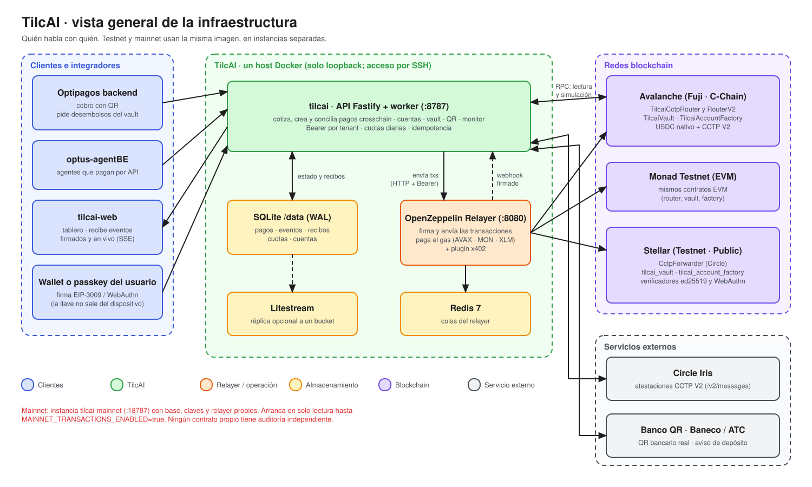
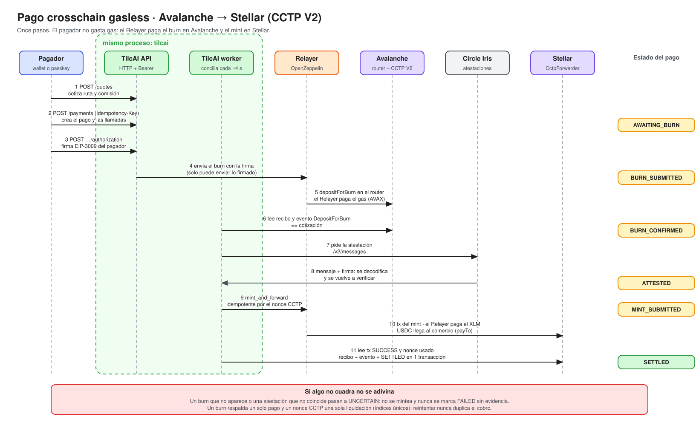
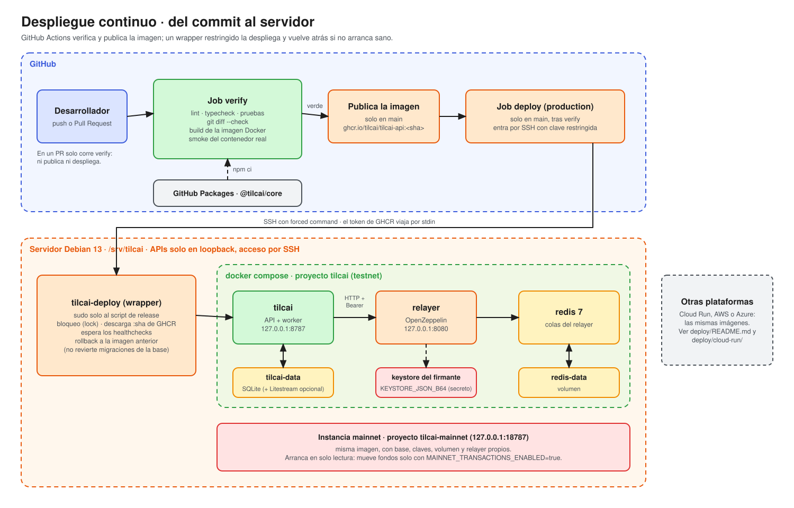
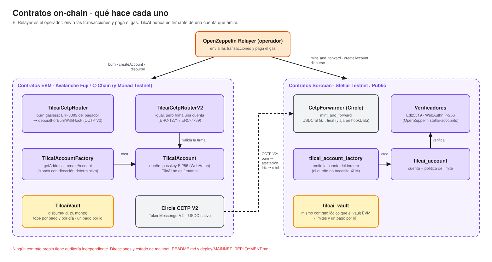
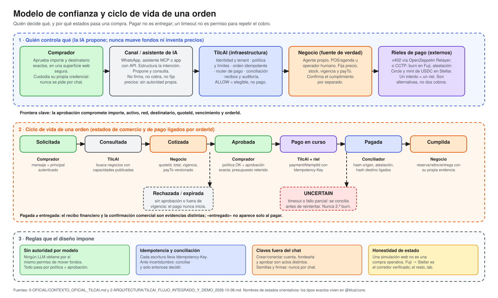
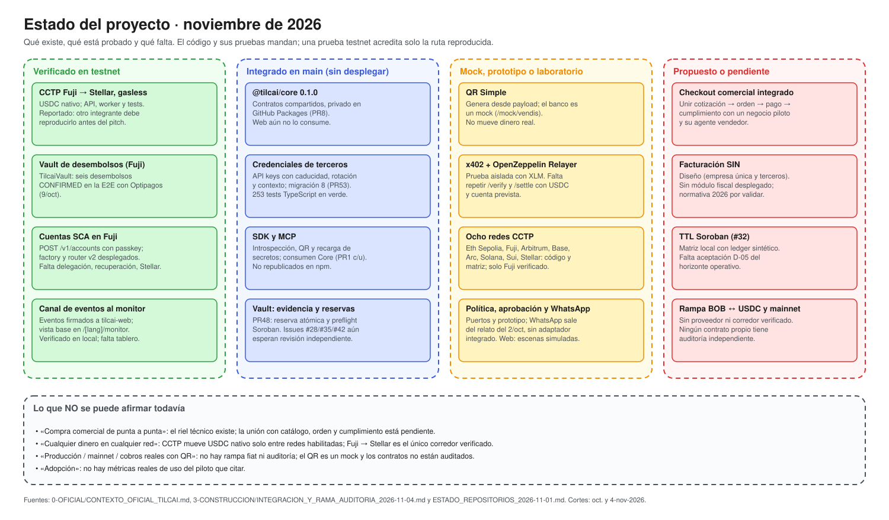

# Diagramas de arquitectura

Seis vistas: las cuatro primeras describen la infraestructura, de lo general a lo concreto; las dos
últimas dan el contexto de producto y el estado real. Todas existen como `.svg`
(se ve aquí y en GitHub) y como `.excalidraw` (editable: abrir en [excalidraw.com](https://excalidraw.com)
con *Abrir* o arrastrando el archivo, o con la extensión de Excalidraw para VS Code).

| # | Diagrama | Responde a |
| --- | --- | --- |
| 1 | [Vista general](01-vista-general.svg) | ¿Quién habla con quién? |
| 2 | [Flujo de un pago crosschain](02-flujo-pago-crosschain.svg) | ¿Qué pasa, paso a paso, entre el pago y la liquidación? |
| 3 | [Despliegue y CI/CD](03-despliegue-ci-cd.svg) | ¿Cómo llega un commit al servidor? |
| 4 | [Contratos on-chain](04-contratos-onchain.svg) | ¿Qué hace cada contrato y quién lo llama? |
| 5 | [Modelo de confianza y ciclo de una orden](05-modelo-confianza-ciclo-orden.svg) | ¿Quién controla qué y por qué estados pasa una compra? |
| 6 | [Estado del proyecto · nov-2026](06-estado-proyecto-nov-2026.svg) | ¿Qué está verificado, integrado, simulado o pendiente? |

## 1 · Vista general

## 2 · Flujo de un pago crosschain

## 3 · Despliegue y CI/CD

## 4 · Contratos on-chain

## 5 · Modelo de confianza y ciclo de una orden

## 6 · Estado del proyecto · noviembre de 2026

## Mantenerlos al día

Los diagramas reflejan [`README.md`](../../README.md), [`deploy/`](../../deploy/README.md) y
`.github/workflows/ci-cd.yml` a la fecha de su creación. Si cambia un puerto, un contrato, un modo
de pago o un paso del CI, edita el `.excalidraw` y vuelve a exportar el `.svg` (*Exportar imagen →
SVG*, sin fondo transparente).

Las vistas 5 y 6 resumen [`CONTEXTO_OFICIAL_TILCAI.md`](../../0-OFICIAL/CONTEXTO_OFICIAL_TILCAI.md) y
[`INTEGRACION_Y_RAMA_AUDITORIA_2026-11-04.md`](../../3-CONSTRUCCION/INTEGRACION_Y_RAMA_AUDITORIA_2026-11-04.md)
(cortes de octubre y 4-nov-2026). También tienen `.excalidraw`, generado junto al `.svg`: los textos van sueltos (sin negrita, que
Excalidraw no admite) y las flechas no están ancladas a las cajas, así que al moverlas hay que
reajustarlas. La 6 caduca rápido: revisarla cada vez que se integre o se verifique algo.

No muestran direcciones de contratos ni secretos. Las direcciones y el estado de mainnet están en
[`deploy/MAINNET_DEPLOYMENT.md`](../../deploy/MAINNET_DEPLOYMENT.md); ningún contrato propio tiene
auditoría independiente.
