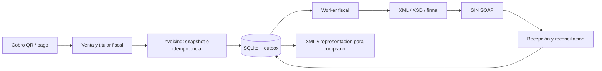

# Facturación en línea Bolivia: fase de empresa única y servicio para terceros

Fecha de investigación: 2026-11-01. Estado: propuesta de implementación; TilcAI no dispone aún de un módulo SIAT autorizado. Las rutas, tablas y etapas siguientes son diseño, no capacidad desplegada.

## Decisión comercial previa

Distinguir tres modelos:

| Modelo | Titular fiscal de la venta | Implementación |
| --- | --- | --- |
| Empresa única vende servicios/productos propios | NIT de esa empresa | Primera fase, un emisor configurado |
| TilcAI provee software a otros contribuyentes | NIT de cada comerciante | Sistema proveedor autorizado y asociación de clientes |
| TilcAI opera como tercero emisor por cuenta del titular | NIT del titular de la operación | Habilitación, asociación y delegación según SIN |

La guía oficial exige autorización del titular para facturación por terceros y sistema de tipo proveedor; describe asociación, aceptación y entrega segura del token delegado. [SIN: facturación por terceros](https://siatinfo.impuestos.gob.bo/index.php/facturacion-en-linea/casos-especiales/facturacion-por-terceros).

**Propuesta:** comenzar con ventas de una empresa real, manteniendo desde el inicio separación entre tenant comercial y emisor fiscal. “Facturar todo con una empresa” solo se habilita para operaciones de las que esa empresa sea titular según contratos y tratamiento tributario. Cobrar por QR o entregar USDC no prueba titularidad. Si el comerciante es el vendedor y TilcAI intermedia, el flujo debe conservar al titular y determinar por separado la factura de comisión de TilcAI. Validar con contabilidad los contratos de venta/reventa/comisión, actividades económicas, obligaciones, moneda y documento sector antes del piloto. Esta es una condición del modelo propuesto, no una autorización obtenida.

## Marco oficial y vigencia

La RND 102100000011 regula el sistema de facturación. Su texto compilado distingue sistema propio de sistema proveedor y exige autorización; la asociación proveedor-cliente forma parte del proceso. [SIN: compilación 2025](https://www.impuestos.gob.bo/wp-content/uploads/2025/10/RND11.pdf). La guía de asociación describe registro del NIT activo por el proveedor y confirmación del cliente. [SIN: asociación](https://siatinfo.impuestos.gob.bo/index.php/facturacion-en-linea/caracteristicas-sfvl/asociacion-de-sistemas).

**Cambio de 2026 que debe cerrarse antes de codificar el adaptador fiscal:** el registro oficial enumera RND 102600000025 (modificación del sistema), 026 (moneda extranjera), 034 (ajustes), 038 (abrogación de designaciones previas) y 042 (prórroga de homologación de productos). Se consultó el índice; los PDF enlazados de 025/026/034/038 no se pudieron extraer en esta sesión. No se certifica el contenido, plazos ni transición resultante. No usar una compilación de 2025 como única especificación vigente ni asumir que los plazos antiguos aplican al emisor. [SIN: resoluciones 2026](https://www.impuestos.gob.bo/index.php/rnd-2026/).

El portal del anexo técnico tampoco estuvo disponible de forma estable. Registrar como pendiente la descarga de WSDL/XSD, normas originales, versiones y hashes; comprobar el anexo Ley 1733 y cuál versión está habilitada en piloto/producción. Ninguna propuesta de cambio se considera automáticamente vigente. [Portal técnico oficial](https://siatanexo.impuestos.gob.bo/).

## Modalidad y habilitación

Electrónica en Línea requiere firma digital; Computarizada en Línea usa credenciales autorizadas. Ambas generan documentos fiscales digitales mediante sistema autorizado. Seleccionar modalidad conforme a asignación y situación del contribuyente, no por preferencia del backend. Para minimizar dependencia criptográfica se puede evaluar Computarizada si el SIN la permite; preparar puerto de firma para Electrónica. [SIN: modalidades](https://siatinfo.impuestos.gob.bo/index.php/12-modalidades-de-facturacion).

Ruta de habilitación propuesta:

1. Identificar empresa, NIT, actividades, sucursales, puntos de venta, documento sector y modalidad aplicable.
2. Elegir sistema propio para uso exclusivo o proveedor para servicio a terceros; no asumir que una autorización propia habilita clientes.
3. Registrar sistema/versión y completar pruebas y autorización de acuerdo con normativa y anexo vigentes. Obtener credenciales por canal seguro.
4. Configurar piloto separado de producción. En fase de terceros completar asociación, confirmación y delegaciones de cada cliente, además de pruebas exigidas.
5. Habilitar producción solo con evidencia de autorización e inicio de facturación del emisor. Supervisar vigencia, renovación, revocación y cambios de versión.

La guía oficial de registro sirve de punto de entrada para el trámite y distingue propio y proveedor. [SIN: registro de características](https://siatinfo.impuestos.gob.bo/index.php/facturacion-en-linea/autorizacion-de-sistemas/registro-caracteristicas).

## Flujo técnico base

Sincronizar fecha/hora y catálogos, obtener token, CUIS y CUFD del contexto correcto; generar CUF y XML con el documento sector aplicable, validar XSD, firmar cuando corresponda, comprimir, calcular hash y enviar. Persistir recepción, consultar estado cuando la respuesta sea incierta y entregar XML y representación al comprador. La secuencia concreta y los nombres de operaciones se fijarán con WSDL vigente. [SIN: emisión y envío](https://siatinfo.impuestos.gob.bo/index.php/facturacion-en-linea/emision-y-envio-de-facturas/emision-y-envio).

CUIS vincula sistema, contribuyente, sucursal y punto de venta; la guía publica 365 días para CUIS y 24 horas para CUFD. Guardar las fechas efectivamente devueltas, renovar anticipadamente y conservar historial; no reemplazar el CUFD de facturas ya generadas. [SIN: códigos de autorización](https://siatinfo.impuestos.gob.bo/index.php/informacion/codigos-de-autorizacion).

La guía técnica requiere sincronización diaria y describe XMLDSig para Electrónica, Gzip y SHA256, así como paquetes de contingencia. Los límites y formatos deben validarse contra la versión activa del anexo, no copiarse como constantes sin versión. [SIN: sistema informático](https://siatinfo.impuestos.gob.bo/index.php/facturacion-en-linea/requerimientos/sistema-informatico).

## Integración con el código existente

Infrastructure ya separa dominio, puertos, repositorios SQLite y adaptadores; API Fastify en `src/apps/api/server.ts`, worker en `src/apps/worker/loop.ts`, tenants en `src/modules/tenants`, cobros en `qrcollect`/`qrsimple` y pagos en Vault/crosschain. La factura debe tener su propia máquina de estados; un pago CONFIRMED no significa factura validada y una factura rechazada no revierte automáticamente un desembolso.

Crear `src/modules/invoicing/{domain,ports,service,repository,routes}.ts`, adaptador `adapters/sin-soap.ts` y generador XML/XSD versionado. Añadir composición en API/worker, migraciones numeradas según estado real y documentación de contratos. No poner SOAP ni reglas tributarias en tilcai-core salvo tipos de dominio compartidos que realmente necesite. SDK expone métodos de facturación; Web incorpora administración fiscal y consulta de documentos con permisos por tenant. Implementar estos cambios en PR separados de las correcciones financieras.

El momento de emisión se determina por la operación y hecho generador aplicable, validado con contabilidad. El evento de cobro es una entrada al proceso comercial; no configurar emisión exclusivamente al llegar USDC a Vault.

## Modelo durable propuesto

| Entidad | Campos y restricciones principales |
| --- | --- |
| fiscal_issuers | ID, NIT, razón social, modalidad, sistema/versión autorizados, estado, ambiente |
| tenant_fiscal_issuers | Tenant, issuer, rol, delegación/contrato, vigencia; autorización explícita |
| fiscal_locations | Issuer, sucursal, punto venta, ambiente, dirección oficial |
| fiscal_credentials | Referencia al gestor de secretos, alcance, expiración/revocación; nunca token plano en logs |
| fiscal_codes | Contexto completo, CUIS/CUFD y control, inicio/fin, versión; historial inmutable |
| fiscal_catalog_versions | Catálogo, fecha sincronización, versión/hash y ambiente |
| invoices | Tenant, issuer, location, venta, idempotency key+hash, snapshot comprador/items/importes/moneda, versión fiscal, CUF, número, estado y código recepción |
| invoice_attempts | Intento, hash de bytes, timestamps, resultado/timeout, respuesta depurada |
| fiscal_events / packages | Contingencia, CUFD previo, intervalo, recepción, integrantes y validación por factura |
| outbox / deliveries | Evento único, arrendamiento de worker, reintentos, entrega y auditoría |

Restricciones únicas: `(tenant,issuer,ambiente,idempotency_key)` y referencia comercial según política acordada; CUF único por ambiente, numeración única por ámbito fiscal fijado en el anexo. No inventar la secuencia solo por tenant. Asignar número y snapshot dentro de transacción corta, registrar envío en outbox en la misma transacción; efectuar SOAP fuera del lock. Usar enteros/decimales exactos según XSD y regla de redondeo versionada, nunca float ni conversión fija USDC=USD=BOB. Mantener tipo de cambio y su fuente aplicable, descuentos, exenciones y documento sector.

Guardar XML final exacto, hash, firma cuando aplique y respuesta del SIN en almacenamiento duradero con control de acceso y copias verificables. Las facturas emitidas no se editan; anulación/reversión/documento de ajuste sigue operación fiscal autorizada y deja historial. Establecer retención con contabilidad según norma vigente; no inventar plazo.

## Estados, idempotencia y contingencia

Estados propuestos: DRAFT → READY → SENDING → VALIDATED o REJECTED; timeout → UNKNOWN. Worker recupera SENDING con lease vencido como incierto y consulta por identidad fiscal antes de reenviar. UNKNOWN conserva número, CUF y XML; no genera otra factura ni nuevo CUF para resolver timeout. Un HTTP 200 o código de recepción no sustituye la validación fiscal. Solicitud repetida con otro contenido devuelve conflicto. Entrega al comprador tiene estado separado y reintento sin reemisión.

Anulación: VALIDATED → CANCELLATION_PENDING → CANCELLED solo con confirmación; respuesta incierta exige consulta. Autorización de actor y motivo de catálogo son obligatorios. Rechazos de datos requieren corrección según procedimiento fiscal vigente, conservando intentos.

Contingencia: registrar causa y tiempos, preservar CUFD aplicable y emitir offline únicamente bajo condiciones autorizadas; al recuperar servicio registrar evento, enviar paquetes y verificar resultado. No interpretar todo error como permiso para usar código expirado. La guía del SIN distingue fallos de comunicación y del servicio CUFD, y recomienda verificar facturas sin respuesta antes de repetir operaciones. [SIN: contingencia](https://siatinfo.impuestos.gob.bo/index.php/facturacion-en-linea/emision-y-envio-de-facturas/ingreso-a-contingencia).

## Fases de entrega y aceptación

| Fase / PR | Entrega | Aceptación |
| --- | --- | --- |
| F0 normativa y negocio | Matriz de normas 2026, anexo/WSDL/XSD versionados, modelo de titularidad, modalidad y sector | Responsable contable valida; requisitos de autorización definidos |
| F1 dominio y persistencia | Issuer único, snapshots, numeración, outbox, permisos, estados | Migraciones/reinicio; dos requests simultáneos no duplican; tenant no elige NIT ajeno |
| F2 adaptador piloto | SOAP, códigos, catálogos, XML, firma si aplica | Casos oficiales por sector; no mezclar ambiente ni códigos |
| F3 resiliencia | Consulta de UNKNOWN, contingencia, anulación, entregas, alertas | Timeout tras recepción y crash tras envío no duplican; recuperación de paquete parcial |
| F4 empresa única | Producción de operaciones propias del titular | Autorización, evidencia piloto, respaldo/restauración y conciliación venta–factura–cobro |
| F5 proveedor/terceros | Onboarding, asociación, delegación por NIT, aislamiento y cuotas | Dos NIT sin fuga de códigos/documentos; revocación detiene emisión; pruebas y habilitación de cada cliente |

Presupuesto orientativo de ingeniería: F0 3–5 días; F1 4–6; F2 5–10; F3 4–7; F4 2–4; F5 5–10. No incluye tiempos de respuesta SIN, firma digital ni validaciones contables. Reestimar tras descargar el anexo vigente. La integración requiere responsable backend, revisor SQL/seguridad, contabilidad y operador fiscal; no están asignados por este documento.

Tests previstos: XML válido e inválido por XSD, vectores CUF/decimal/redondeo, firma, Gzip/hash, numeración concurrente, idempotencia/crash, respuesta SOAP fault/timeout, consulta posterior, tokens vencidos, catálogos antiguos, cambio de día y CUFD, paquete parcialmente rechazado, revocación, acceso entre tenants y restauración de backups. Unit/integración offline con fake SOAP; pruebas oficiales en piloto durante habilitación, con credenciales separadas. Métricas: documentos UNKNOWN/rechazados, antigüedad outbox, renovación códigos, delegaciones/certificados y entrega. Ningún secreto ni datos del comprador en monitor público.

## Paso de empresa única a terceros

Mantener `issuer_id` inmutable en cada factura. Al incorporar un comerciante, completar autorización y permisos, crear su contexto fiscal y fijar fecha de corte comercial: nuevas ventas de ese titular usan su NIT; documentos históricos permanecen en el emisor original. Un tenant puede operar diferentes contextos solo mediante permisos explícitos. Exportar y conciliar históricos por emisor; no renumerar ni volver a emitir facturas antiguas durante migración.

Pendientes concretos: empresa/NIT y rol comercial, catálogo inicial de ventas, sucursales/puntos, modalidad asignada, documento sector, responsable de firma, política monetaria vigente, contrato de delegación, normativa 2026 y versión de anexo aplicable. La documentación permite implementar el esqueleto y pruebas offline; la emisión real depende de cerrar esos datos y habilitaciones.
