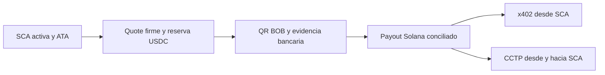

# Plan Solana: cuentas, rampa, x402 y crosschain

**Avance de implementación · 2026-11-27:** SCA Squads + ATA USDC emitidas y FINALIZED en Devnet mediante el fork OpenZeppelin propio (2226ebc2). Core experimental, migración 10 y cliente relayer tipado implementados; 461 pruebas pasan. Provider HTTP, grants, transferencia USDC, rampa, x402 y CCTP desde SCA siguen pendientes. [Incremento 1 y evidencia](https://www.notion.so/4252dc79a425813a800cec195a916238). El diagnóstico siguiente corresponde al punto de partida.

**Revisión: 2026-11-27. Estado: planificación; capacidades Solana pendientes de implementación.** [Notion Dev Docs](https://www.notion.so/4252dc79a4258163b1c7d34e3f71a5b6): plan de cuatro prioridades sincronizado; capacidades pendientes de implementación. Business Docs: requisitos publicados y verificados en [Capacidades y roadmap](https://www.notion.so/3e2f83931c2d803aac5df8d307c5d920), enlazados desde [Producto y negocio](https://www.notion.so/3e2f83931c2d809b83b7df3a338fbd5d). Reorganización del 2026-11-27: cinco páginas actualizadas reutilizando sus bloques, dos vacíos aprovechados y ningún bloque/página eliminado; el contador de cuota no se reduce al borrar contenido.

Tilcai debe integrar **emisión de SCA Solana, rampa BOB→USDC en Solana, x402 y crosschain**, según la prioridad explícita del usuario: «las funciones mas importantes son emitir scas en solana, rampa bob a usdc en solana, x402 support y corsschain». El producto objetivo es emitir una cuenta del usuario, cargarla mediante QR BOB, gastar desde esa misma cuenta en APIs x402 y mover USDC entre redes. La base actual aporta emisión EVM/Stellar, QR, FX, persistencia y un laboratorio CCTP Solana, pero esas piezas todavía no forman el flujo solicitado. **Una wallet convencional o un corredor crosschain aislado no cumplen la emisión SCA ni el producto integrado.** La primera decisión técnica debe probar SCA×x402×CCTP antes de seleccionar proveedor y depositar fondos. Este plan sustituye la propuesta inicial centrada en un corredor y mantiene separados hechos observados, decisiones propuestas y aceptación pendiente.

## El código ofrece piezas útiles y cuatro brechas concretas

La revisión cubrió árboles locales y documentación; no verificó servidores, balances, programas desplegados, proveedores comerciales ni operación bancaria. HEAD locales en `main`: core `faa95af`, infrastructure `59917c4`, engine `b957f4d`, SDK `9e4513b`, MCP `d4d19db`, web `df64d05`. Se conservaron cambios preexistentes. No hubo instalaciones, nuevas pruebas tras la aclaración, despliegues o movimientos de fondos.

| Pilar | Base observada | Brecha para Solana |
|---|---|---|
| Emisión SCA | `/v1/accounts`, tenant/externalRef/owner, idempotencia, cuota, reconciliación; providers EVM y Stellar | Provider Solana, programa/autoridad, vault PDA y ATA, políticas y activación verificadas |
| Rampa | QR BOB, proveedores y callbacks; FX con enteros; desembolsos EVM/Soroban | Orden que una cotización firme, cobro acreditado, reserva USDC y payout Solana único |
| x402 | SDK V2/exact EVM/Stellar, buyer/seller y cliente de facilitador | Payload SVM, autorización desde SCA, facilitador compatible y consumo durable |
| Crosschain | API/worker EVM→Stellar; laboratorio Solana V1/V2 con ATA/PDAs | Adaptadores integrados y burn/receive autorizados por SCA, con conciliación persistente |

`AccountService` ya evita duplicar tenant/externalRef/owner, controla carreras y reconcilia despliegue. Sin embargo, **delegación/revocación EVM y Stellar lanzan `NOT_YET`**; su presencia en interfaces no acredita sesiones operativas. Evidencia: `tilcai-infrastructure/src/modules/accounts/service.ts:59`, `accounts/evm/provider.ts:88` y `accounts/stellar/provider.ts:84`. Solana necesitará inspeccionar estructura y autoridad onchain, en lugar de interpretar “dirección con código” como cuenta activa.

Hay dos riesgos financieros explícitos: FX devuelve `indicative:true`, por lo que no reserva liquidez ni compromete un cambio; y el desembolso de vault no exige `collectionId` o `quoteId`. Además, QR puede inferir importe cuando el proveedor marca pagado sin evidencia completa. Esos comportamientos no bastan para entregar USDC irrevocable. Evidencia: `tilcai-infrastructure/src/modules/fx/service.ts:35`, `qrcollect/service.ts:232`, `src/apps/api/server.ts:75` y `vault/service.ts:63`.

La infraestructura usa TypeScript/Fastify, SQLite, viem y Stellar SDK. Su registro durable conserva cotizaciones, etapas, nonce, eventos y recibos, con aislamiento tenant e idempotencia; no acredita contabilidad de doble entrada. SQLite opera bajo contrato de un host/grupo escritor. API, SDK y MCP siguen forzando EVM→Stellar; x402 solo contempla signers EVM/Stellar. El monitor es observabilidad, no autoridad financiera; la web reconoce pendiente la compra comercial completa. Evidencia: `tilcai-infrastructure/src/db/sqlite.ts:6`, `src/modules/crosschain/service.ts:35`; `tilcai-sdk/src/payments.ts:93`, `src/x402/client.ts:10`; `tilcai-mcp/src/server.ts:12`; `tilcai-web/src/lib/content/docs-content.ts:20`.

| Suite local ejecutada anteriormente | Resultado y límite |
|---|---|
| Infrastructure | 56 reportados: 29 pasan/27 fallan; errores de carga de `tilcai-core/contracts` y `/amount`, entre otros; no demuestra 27 fallos funcionales |
| SDK | 11 archivos no cargan por `tilcai-core` ausente |
| Engine CCTP | No arranca: falta `tsx` |
| MCP | 7/7 pasan, sin transacciones Solana |
| Web | 121/122 pasan; falla composición en `test/solutions-section.test.ts:57` |

No se ejecutaron build/typecheck, navegador, wallets ni E2E blockchain. La instalación reproducible es un prerrequisito pendiente, sin ocultar esta línea base.

## La SCA debe autorizar los cuatro flujos desde una misma cuenta

Se propone un `SolanaSmartAccountProvider` intercambiable: emisión, lectura, preparación de transferencia/ejecución y gestión de grants. Cada cuenta registra tenant, subject/externalRef, cluster, provider/versión, program ID, settings, vault/deposit owner, ATA USDC, autoridad, recuperación y política. **Settings, dirección de depósito y ATA son roles distintos**. La activación exige comprobar program owner, discriminador/PDA, autoridades y asociación de token; enviar una transacción o derivar una PDA no basta. Las PDA firman mediante el programa y CPI, no mediante una clave privada propia. ([Modelo PDA oficial](https://solana.com/developers/docs/core/pda)).

La emisión y el patrocinio se separan del control de fondos: el dueño autoriza; Tilcai autentica tenant y puede pagar SOL/rent; el agente usa un permiso limitado. El fee payer no debe retirar fondos ni modificar propietarios. Ed25519 inicial y passkey P256 son decisiones distintas: anunciar passkeys exige comprobar WebAuthn/P256 y recuperación reales. Una wallet auxiliar con fondos extraídos de la SCA no demuestra x402 o CCTP desde la SCA.

**Candidato inicial: familia Squads, sujeto a prueba.** V4 ofrece SDK y configuración verificable, pero `SpendingLimit` carece de expiración absoluta; sus signers son independientes de los miembros, así que quitar un miembro no revoca el grant. Destinos vacíos permiten cualquier destino. Ese límite ejecuta transferencias, no autorización genérica CCTP. Una `config_authority` controlada por Tilcai cambia las garantías de control y debe declararse. ([SDK v4](https://docs.squads.so/main/development/typescript/overview), [SpendingLimit fuente](https://raw.githubusercontent.com/Squads-Protocol/v4/main/programs/squads_multisig_program/src/state/spending_limit.rs), [ejecución del límite](https://raw.githubusercontent.com/Squads-Protocol/v4/main/programs/squads_multisig_program/src/instructions/spending_limit_use.rs), [multisig controlada](https://docs.squads.so/main/development/reference/controlled-multisigs)).

Squads Smart Account Program es una implementación separada: su documentación publica políticas y programas, pero también declara desarrollo activo/SDK no publicado; hay que verificar release, binario y auditoría aplicables. Grid exige contrastar políticas y acceso del proveedor. LazorKit es candidato para passkeys, con divergencias documentales entre versiones/redes/sesiones que impiden asumir producción. Ninguno queda seleccionado por esta investigación. ([Squads Smart Account](https://raw.githubusercontent.com/Squads-Protocol/smart-account-program/main/README.md), [Grid](https://grid.squads.xyz/welcome), [LazorKit redes](https://docs.lazorkit.com/networks), [sesiones](https://docs.lazorkit.com/concepts/session-keys)).

El spike obligatorio emitirá SCA+ATA, recibirá USDC devnet, transferirá con autorización, pagará x402 y probará burn CCTP desde esa cuenta. Evaluará grants con mint, destinatarios/programas, máximo por transacción/acumulado, vencimiento y revocación **onchain**. Después de caducar/revocar, un envío directo a RPC debe fallar; un rechazo del backend no basta. Si falta una política, se declara la capacidad ausente: v4 con gasto aprobado por owner puede validar emisión, pero no sesiones temporales completas. Programa propio solo si los proveedores fallan y con alcance/auditoría separados.

## La rampa exige una orden firme y x402 exige un facilitador compatible

La nueva entidad propuesta `OnrampOrder` une tenant/usuario, SCA activa, ATA, cluster/mint, quote firme, QR, evidencia bancaria, reserva y payout. La quote fija BOB bruto, spread/comisiones, USDC neto, tasa/fuente/fecha, redondeo, versión y caducidad; el FX indicativo actual sirve como entrada, no como contrato ejecutable. Se reserva inventario USDC y presupuesto SOL antes de emitir QR; sin liquidez se rechaza o espera explícitamente. El operador/proveedor que recibe BOB y abastece USDC, sus límites y responsabilidades comerciales siguen pendientes de confirmación.

Estados propuestos: `QUOTED → LIQUIDITY_RESERVED → AWAITING_BOB → BOB_CONFIRMED → SETTLING → SETTLED`, con expiración, revisión, reembolso y resultado incierto explícitos. `BOB_CONFIRMED` exige importe/moneda/referencia/beneficiario esperados y evidencia del proveedor; callback autenticado y consulta bancaria según contrato. No inferir importe faltante, aceptar callback como liquidación ni dejarle elegir destino. QR de un uso, referencias bancarias únicas y claim/reserva/payout atómicos impiden doble entrega. Pago parcial, excedente, tardío, reverso o cancelado pasa a una política documentada de revisión/reembolso; no cambia silenciosamente la tasa.

Una tesorería USDC prefondada permite probar la rampa sin esperar reposición CCTP. Sus claves/permiso son distintos del owner SCA; una wallet de tesorería no se anuncia como vault programado. Persistir signature antes de reintentar, verificar destino/mint/importe y conciliar banco↔orden↔inventario↔cadena. Si BOB llega y falta liquidez o falla payout, conservar obligación y estado visible; timeout no crea segundo envío. `SETTLED` requiere USDC finalizado en el ATA de esa SCA. La API propuesta incorpora `/v1/onramp/quotes`, `/v1/onramp/orders` y consulta por ID; no existen aún como rampa Solana.

Para x402 se propone **V2, `exact`/SVM USDC, buyer y seller**. La especificación permite transferencia por CPI desde smart wallet, con transacción versionada parcialmente firmada y fee payer; el facilitador puede imponer restricciones adicionales. `@x402/svm` requiere habilitar `enableSmartWalletVerification`, simulación/inner instructions/ALTs y programa permitido; su documentación incluye Squads v4/Smart Account en la allowlist. Por ello, compatibilidad es posible, pero no automática. ([Spec exact-SVM](https://raw.githubusercontent.com/x402-foundation/x402/main/specs/schemes/exact/scheme_exact_svm.md), [implementación exact](https://raw.githubusercontent.com/x402-foundation/x402/main/docs/schemes/exact.mdx)).

Priorizar el facilitador/plugin x402 del fork OpenZeppelin por instrucción del usuario y consultar `/supported`; su soporte Solana debe verificarse y no garantiza la SCA elegida. CDP queda como alternativa por evaluar, sin cambio automático de proveedor. El gate es **SCA real→402→autorización→verify→settle→recurso** en devnet. Si no pasa, estimar facilitador Tilcai separado con verificación SCA y signer remoto/políticas; Kora protege patrocinio, no sustituye x402. No compartir privilegios con la rampa. ([CDP](https://docs.cdp.coinbase.com/x402/seller/facilitator), [facilitador Solana](https://solana.com/developers/docs/tools/x402-facilitator)).

Persistir tenant, recurso, método/body hash, requirements, mint/red/payTo/importe, expiración y firma/nonce; consumir pago una vez en almacenamiento compartido. `verify` no liquida. Para acciones con efectos, liquidar antes de ejecutar y conservar resultado durable: retry devuelve el mismo recurso, y fallo posterior exige recuperación/reembolso, sin nuevo cobro. Rechazar replay entre recursos/tenants y sustitución de importe, programa, fee payer o destinatario. El límite del agente debe mantenerse onchain aunque evite la API Tilcai.

## Crosschain reutiliza el laboratorio y conserva la autoridad SCA

El alcance progresivo es **Solana↔Stellar y Solana↔Avalanche con CCTP V2**, un corredor/dirección completo antes del siguiente. Primero puede abastecer tesorería; la exposición al usuario exige burn desde SCA y recepción en ATA/control correcto. Circle documenta dominios Avalanche **1**, Solana **5**, Stellar **27**; dominio no equivale a chain ID. ([Redes Circle](https://developers.circle.com/cctp/concepts/supported-chains-and-domains)).

Extraer builders, PDAs y parseo del laboratorio; sustituir keypair local y JSONL final por providers/persistencia. El burn requiere ejecución CCTP autorizada por la SCA: un SpendingLimit de transferencia no lo demuestra. Destino Solana exige token account USDC existente, mientras Solana Pay usa owner; destino Stellar exige `CctpForwarder` en `mintRecipient` y `destinationCaller`. Validar programas/IDL, versiones y precisión CCTP seis/Stellar siete; configuración errónea puede inmovilizar fondos. ([Programas Solana](https://developers.circle.com/cctp/references/solana-programs), [Stellar](https://developers.circle.com/cctp/references/stellar)).

Corregir además `solReceive`: ante ATA ausente prepara la del signer, no necesariamente beneficiario; `resume` puede llegar sin preparación previa (`tilcai-cctp-engine/src/cctp/solana.ts:149`, `src/cctp/route.ts:253`). Probar destinatario distinto del operador. Persistir burn, event account, mensaje/nonce, atestación y mint, con unicidad y reanudación; no repetir burn por fallo Iris/receive. Registrar cluster, signature, blockhash/`lastValidBlockHeight`, importe entero y evidencia antes de avanzar. Ante incertidumbre, consultar/retransmitir mismos bytes válidos; reconstruir exige resolver evidencia y nueva autorización. Finalidad y atestación son relojes distintos, sin SLA inventado. ([Confirmación Solana](https://solana.com/developers/cookbook/transactions/confirmation), [finalidad Circle](https://developers.circle.com/cctp/concepts/finality-and-block-confirmations)).

## Cinco fases convierten las prioridades en entregables comprobables

Las superficies siguientes son propuestas. Core versionará familias/owners/policies/capabilities y referencias base58; infraestructura añadirá provider, rampa, adaptadores x402/CCTP; SDK separará signer owner/delegado/sponsor; MCP expondrá cuenta/rampa/pagos por scopes; web mostrará cuenta, grants, BOB recibido y USDC disponible. API keys operadoras quedan en servidor. Los SDK actuales Node no acreditan compatibilidad navegador: diseñar cliente de firma específico. Fijar versiones compatibles de herramientas Solana mediante spike/lockfile. ([SDK oficial](https://solana.com/developers/docs/clients/official/javascript)).

| Fase / ID · esfuerzo | Entregable y repositorios | Dependencias y aceptación |
|---|---|---|
| 0 / SOL-01 · 2–4 días | Baseline reproducible; core/infra/SDK/engine/web | Reutilizar #75; instalar desde lock y resolver imports/tsx, registrar baseline sin ocultar fallo web |
| 0 / SOL-02 · 3–5 | ADR y spike SCA×x402×CCTP; engine/infra/SDK | SOL-01; matriz emisión/gasto/grant/TTL/revoke/CPI/recuperación con evidencia devnet; proveedor elegido o brechas explícitas |
| 0 / SOL-03 · 1–2 | Acuerdo operativo rampa; docs/infra | Actor BOB, liquidez, fees, tasa/expiración, reversos y responsabilidad definidos; no asumir acceso comercial |
| 1 / SOL-04 · 2–3 | Contratos/capabilities; core/consumidores | SOL-02; SCA/settings/vault/ATA separados, CAIP/red/mint y TxReference validados; compatibilidad EVM/Stellar |
| 1 / SOL-05 · 3–5 | Emisión SCA+ATA durable; infra/SDK | SOL-04; replay idempotente, owner conflict, tenant ajeno, creación incierta y activación onchain correctos |
| 1 / SOL-06 · 3–5 | Grants, revocación, recuperación y sponsor; infra/SDK | SOL-02/05; gasto fuera de presupuesto/TTL/revoke falla por RPC; sponsor sin autoridad de retiro; sin falsa paridad passkey |
| 2 / SOL-07 · 2–4 | Quote firme y reserva; core/infra | SOL-03/05; enteros BOB2/USDC6, expiración y liquidez bloquean compromisos inválidos |
| 2 / SOL-08 · 3–5 | OnrampOrder y QR/evidencia; infra | SOL-07; evento autenticado/deduplicado, importe exacto, late/reversal y callback sin importe no acreditan silenciosamente |
| 2 / SOL-09 · 3–5 | Payout/conciliación rampa; infra/SDK | SOL-08; exactamente una entrega al ATA SCA; falta liquidez, reinicio y ACK perdido conservan obligación/evidencia |
| 3 / SOL-10 · 3–5 | Buyer x402 desde SCA; SDK/core | SOL-02/06; exact-SVM con facilitador habilitado, CPI inspeccionada y presupuesto real; sin wallet puente |
| 3 / SOL-11 · 3–5 | Seller/Fastify y replay durable; infra/SDK | SOL-10; verify≠settle, recurso solo tras liquidación, doble retry no cobra y otro recurso/tenant no reutiliza pago |
| 3 / SOL-12 · 3–5 | Crosschain SCA y reposición; engine/infra | SOL-02/06; V2/Forwarder/ATA verificados; un corredor pasa burn/attest/mint/restart; inversos se habilitan tras su propia prueba |
| 4 / SOL-13 · 2–4 | UX/MCP de cuatro capacidades; web/MCP/SDK | SOL-05/09/11/12; cuenta/grant/rampa/pago con scopes, estados y evidencia; sin semillas/API keys en cliente |
| 4 / SOL-14 · 2–4 | E2E integrado y regresión; todos | SOL-13; segunda persona reproduce SCA→BOB→USDC→x402→CCTP, revoke y pruebas negativas; cadenas anteriores sin regresión |
| 4 / SOL-15 · 2–3 | Operación/restore/alertas; infra/docs | SOL-09/11/12; conciliación banco/inventario/cadena, recuperación durable y apagado de nuevas órdenes sin abandonar pendientes |
| 4 / SOL-16 · 1–2 | Revisión y canary operativo; todos | SOL-14/15 y seguridad acreditada; límites/rollback/evidencias completos; mainnet pendiente de habilitación posterior |

La base suma **38–66 días-persona** estimados si proveedor SCA y facilitador cubren requisitos y hay acceso bancario/liquidez; paralelismo no convierte esa cifra en fecha prometida. SOL-01 dimensiona deuda adicional. Un programa propio de política añade como hipótesis **3–6 semanas de implementación más auditoría independiente**, reestimadas tras el spike; facilitador propio, onboarding comercial y expansión de corredores añaden esfuerzo separado. No se comprometen cinco u ocho semanas calendario.

La aceptación integrada exige misma SCA en los cuatro tramos; dos tenants aislados; mint/programa/destino alterados rechazados; límites concurrentes y grants expirados/revocados probados por RPC; doble webhook y doble settle sin duplicación; pago tardío/reverso y liquidez insuficiente trazables; burn completado con recepción caída recuperable. El piloto bancario real exige evidencia real del proveedor: mock+devnet valida software, no la rampa comercial.

El [plan de seguridad existente](https://www.notion.so/4202dc79a42581c18802ca6a5b7cbdaf) aporta dependencias, no evidencia actual de cierre: #61 backups, #62/#63 secretos, #64 autorización, #65 confirmación monetaria QR, #66 vínculo cobro/desembolso, #67/#68 tráfico/HTTP, #69 firmantes, #70 persistencia, #71 concurrencia QR, #72 dependencias, #73 FX y #74 auditoría; #33 revisa topología. No se comprobó aquí su estado GitHub ni se crearon issues nuevas.

Presupuestar RPC HTTP/WS/historial, fees/rent SCA/ATA/event accounts, sponsor, inventario USDC/SOL, riesgo de tasa y liquidación BOB, signer seguro, workers/DB/backups, facilitador, auditoría y soporte; no hay volumen ni mediciones para precios o SLA. El rollback pausa emisión/quotes/grants nuevos según capacidad y mantiene cobros recibidos, payouts, settles y burns en conciliación. Las métricas deben mostrar tiempo BOB→USDC, operaciones inciertas por antigüedad, reservas/inventario, fallos x402/replays y etapas CCTP. La salida del plan es una arquitectura y aceptación revisables; ninguna función Solana se declara implementada por esta tarea.
